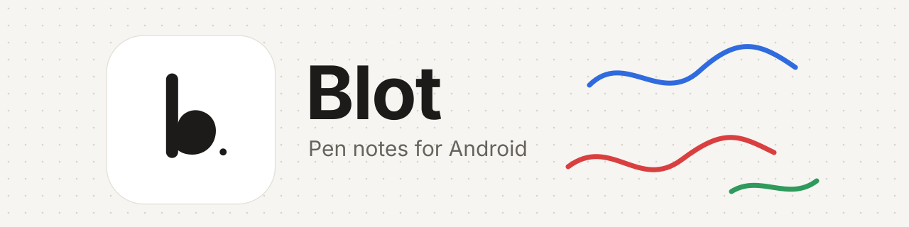
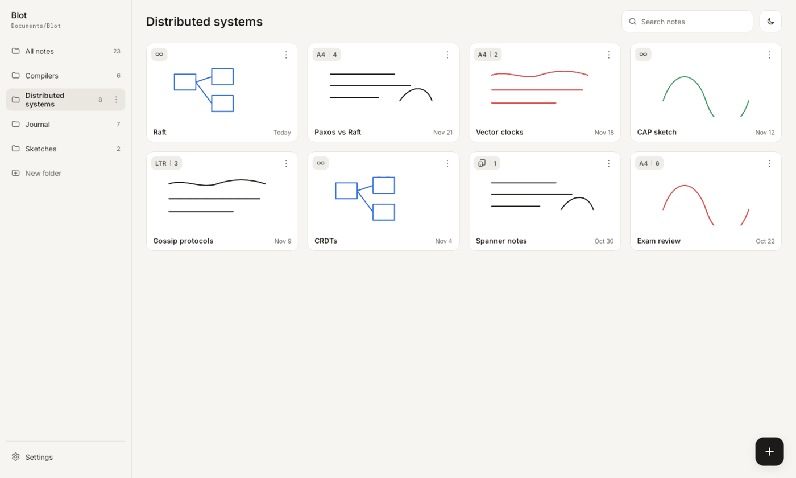
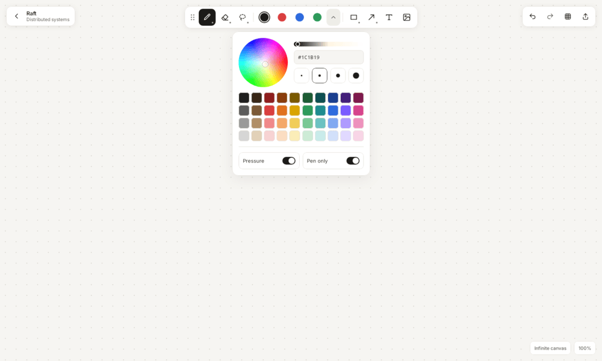
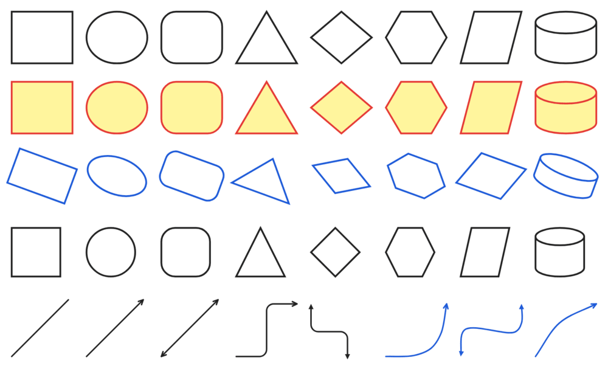
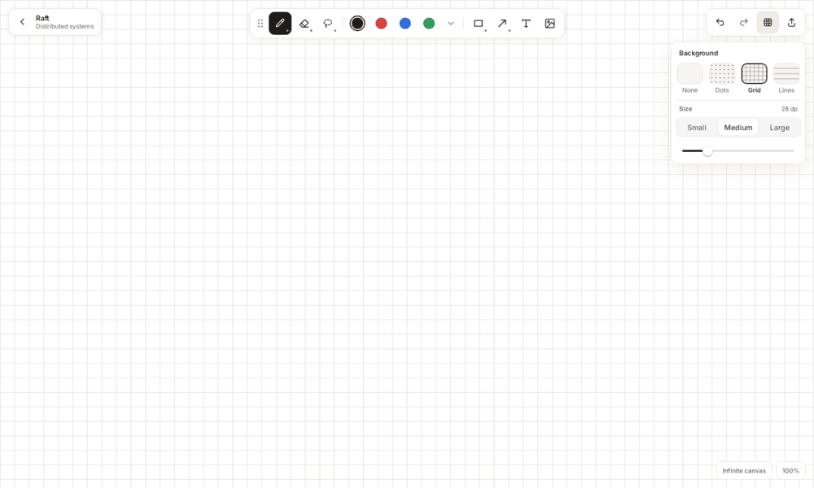
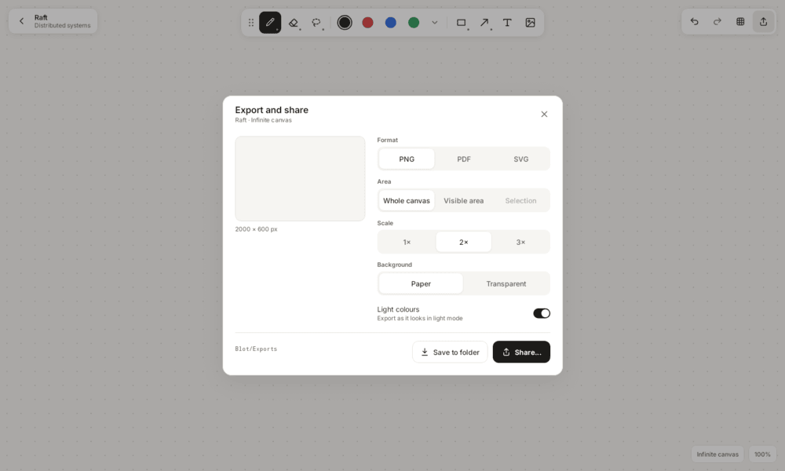
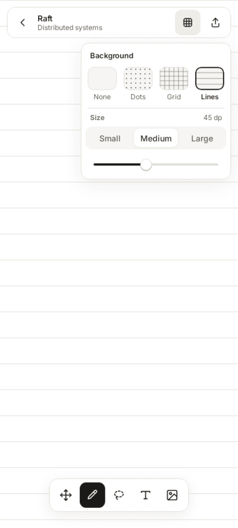

<p align="center">
  <picture>
    <source media="(prefers-color-scheme: dark)" srcset="assets/readme/banner-dark.svg">
    
  </picture>
</p>

<p align="center">
  
  
  
  
</p>

Blot is a pen-based notes app for Android. It is built for a Lenovo TB-J616F tablet with a Lenovo pen, and also runs on a Pixel 7a for viewing and light editing. Notes are plain JSON in a folder you choose, so they sync with whatever syncs folders.

<p align="center">
  <picture>
    <source media="(prefers-color-scheme: dark)" srcset="assets/readme/library-dark.png">
    
  </picture>
</p>

## Features

- **Ink.** Strokes are drawn through Android's low-latency front buffer, with pressure-sensitive width (switchable) and an option to let only the pen draw while fingers pan and zoom.
- **Tools.** Pen; eraser (whole stroke or partial); pointer with lasso and rectangle select, move, scale, rotate, grouping and stacking; shapes (rectangle, ellipse, rounded rectangle, triangle, diamond, hexagon, parallelogram, cylinder), with optional fill; lines, elbow connectors and curved arrows with arrowheads; markdown text boxes with LaTeX maths. The pen's side buttons switch to the pointer or erase.
- **Colour.** Four quick colours and a full palette. Dark mode maps colours into a lightness band so they stay distinct, and the colour panel shows what each one will draw as.
- **Canvas.** An infinite canvas, or pages: A4, Letter or the size of the screen. Pinch to zoom from 20% to 800%.
- **Backgrounds.** Dots, grid or ruled lines, in three sizes, per note.
- **Library.** Notes in folders, with search, thumbnails, rename and move. A folder is an ordinary directory.
- **Export.** PNG, PDF and SVG, for the whole canvas, the visible area or a selection, shared or saved to a folder.
- **Your files.** Each note is a directory holding `note.json`. Pick the folder in Settings and sync it with Syncthing or anything else. There is no account and no cloud.
- **Updates.** Builds from the dev shell update themselves from depot; see below.

Still to come: image import and paste (images already draw and export), and layers. Open work is in [docs/TODO.md](docs/TODO.md).

## Screenshots

These are rendered by the test suite (Robolectric) with sample notes, not captured on a device.

<table>
  <tr>
    <td width="50%" align="center">
      <picture>
        <source media="(prefers-color-scheme: dark)" srcset="assets/readme/colours-dark.png">
        
      </picture>
      <br><sub>Colour panel, with a pen width and the pressure and pen-only switches. In dark mode it shows the colour each pick draws as.</sub>
    </td>
    <td width="50%" align="center">
      <picture>
        <source media="(prefers-color-scheme: dark)" srcset="assets/readme/shapes-dark.png">
        
      </picture>
      <br><sub>Eight shape kinds, and straight, elbow and curved lines with arrowheads.</sub>
    </td>
  </tr>
  <tr>
    <td width="50%" align="center">
      
      <br><sub>Background patterns: dots, grid or ruled lines.</sub>
    </td>
    <td width="50%" align="center">
      
      <br><sub>Export as PNG, PDF or SVG.</sub>
    </td>
  </tr>
</table>

<p align="center">
  
  <br><sub>The phone layout.</sub>
</p>

## Develop

```sh
nix develop                      # JDK, Gradle wrapper, build SDK, emulator scripts
emu-tablet                       # boot tab-31 (Android 12, 2000x1200 @ 204dpi) as emulator-5556
EMU_API=35 emu-tablet            # same shape on Android 15 (tab-35)
emu-up                           # boot emu-35 (Pixel 7 profile) as emulator-5554; EMU_API=31 for emu-31

./gradlew :core:test             # host-only model/geometry tests
./gradlew :app:testDebugUnitTest # Robolectric; also renders the UI screenshots into app/build/ui-shots
ANDROID_SERIAL=emulator-5556 ./gradlew :app:connectedDebugAndroidTest
ANDROID_SERIAL=emulator-5556 ./gradlew :app:connectedAndroidTest -Pblot.testBuildType=shrunk   # against R8-shrunk code
./gradlew :app:assembleRelease   # shrunk release APK
emu-publish app/build/outputs/apk/release/app-release.apk   # publish to depot (clean tree)
EMU_PORT=5556 emu-shot           # screenshot of the tablet emulator
```

Builds are signed with `~/.android/blot.jks`, outside the repo, so every build installs over the last. Create it once with
`keytool -genkeypair -keystore ~/.android/blot.jks -alias blot -keyalg EC -groupname secp256r1 -validity 10000 -storepass blotkey -keypass blotkey -dname CN=blot`.
An untracked `signing.properties` (`signing.store`, `signing.password`) points elsewhere; without the key, builds use the debug key.

Install `app/build/outputs/apk/release/app-release.apk` to try a build without adb. Builds from the dev shell update themselves from depot (android-emu) once a device has enrolled with Tailscale on; builds outside it have no updater. The developer screens (pen test, canvas test, UI preview) are under Settings → long-press About.

Docs live in [docs/INDEX.md](docs/INDEX.md). Open work is in [docs/TODO.md](docs/TODO.md).

## Licence

MIT; see [LICENSE](LICENSE).

Blot bundles the Inter typeface (SIL OFL 1.1), a Latin Modern Math subset (GUST Font License), AndroidX and the Kotlin libraries (Apache 2.0), commonmark-java (BSD 2-Clause), and a maths typesetter ported from AndroidMath and iosMath (MIT). The full texts are under Settings → About → Licences.
